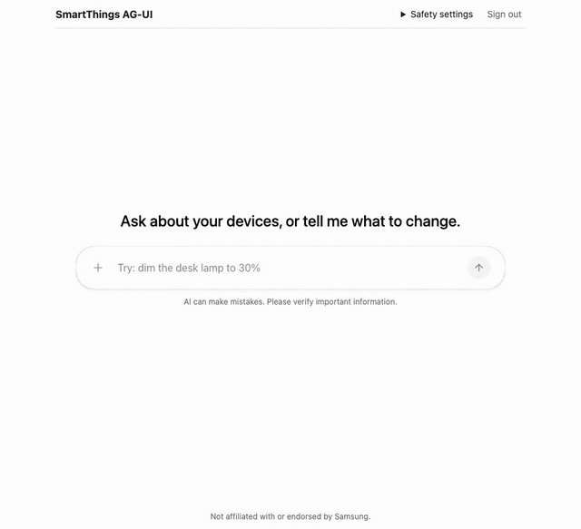

# SmartThings AG-UI

Talk to your SmartThings home from any [AG-UI](https://docs.ag-ui.com) agent, with device cards in the chat, a confirmation step before anything security-sensitive moves, and a SmartThings token that never leaves your browser.



*Recorded against SmartThings virtual devices .*

> Not affiliated with or endorsed by Samsung. "SmartThings" is used only to describe what this works with.

## How it works

```
Browser (React + CopilotKit, direct connect)
  ├─ SmartThings token (personal token, or OAuth)      ← never sent to the agent
  ├─ frontend tools  → fetch api.smartthings.com        (CORS allows it)
  ├─ confirmation cards for locks, doors, valves, security, scenes
  ├─ device cards rendered from each tool's result
  └─ the home (devices, rooms, scenes) as agent context
        │  AG-UI over HTTP/SSE
        ▼
Any AG-UI agent. Reference: Python, FastAPI + the LlamaIndex AG-UI router.
It has no SmartThings code and no SmartThings credentials.
```

SmartThings capabilities are registered with CopilotKit as **frontend tools**: the agent decides to call `set_level`, the browser runs it against `api.smartthings.com` with the user's token, and the agent gets the result back. The same pattern as a Home Assistant client whose tools run at home, for a platform that has no in-app conversation surface to host one.

| Tool | What it does |
|---|---|
| `list_devices`, `get_device_status`, `list_scenes` | Read the home. The device and scene list is also sent as context, so most requests need no lookup. |
| `set_switch`, `set_level`, `set_color`, `set_thermostat` | Typed tools for the common capabilities. Small models call these much more reliably than a generic one. |
| `execute_command` | Anything else on an allowlist (lighting, climate, shades, fans, media), with arguments checked against the capability's definition from the public API. |
| `confirm_command` | Locks, doors, garage doors, valves and security systems. Off by default; asks the person before anything happens. |
| `run_scene` | Runs a scene after the person confirms. |

## Security model

An agent unlocking a door is the failure that matters, so:

1. **Deny by default.** Commands for `lock`, `garageDoorControl`, `doorControl`, `securitySystem` and `valve` are refused unless the user turns that capability on in *Safety settings*. Until then `confirm_command` isn't even offered to the agent.
2. **A person confirms.** When it is on, the agent can only *ask*: a card shows what will happen, and the command runs only when the person presses the button. The policy is checked again at that moment.
3. **No side doors.** A device that has any of those capabilities can't be commanded through any other tool (some valves also expose `switch`), and `execute_command` only reaches an allowlist. `execute`, `ocf`, firmware updates, ovens and vendor-specific capabilities are out of reach.
4. **Scenes always ask**, because a scene can unlock a door and the public API doesn't reliably say what a scene contains.
5. **The token stays in the browser.** The agent sees tool arguments and results only. Tokens are kept in memory, not storage.

The list of confirm-only capabilities is hard-coded on purpose: the API's per-command `sensitive` flag isn't a safety signal (`lock.unlock` reports `"sensitive": false`). The rules live in one small file, [`policy.ts`](packages/smartthings-agui/src/policy.ts), with tests in [`tools.test.ts`](packages/smartthings-agui/test/tools.test.ts) and the confirmation flow tested end to end in [`roundTrip.test.tsx`](packages/smartthings-agui/test/integration/roundTrip.test.tsx).

## Run it

Requirements: Node 24, Python 3.14 with [uv](https://docs.astral.sh/uv/), a SmartThings account, and an OpenAI-compatible model with native tool calling.

```sh
npm install
(cd agent && uv sync)
```

**1. The agent.** Point it at any OpenAI-compatible endpoint:

```sh
cd agent
# LM Studio (default endpoint http://localhost:1234/v1):
AGENT_MODEL=google/gemma-4-26b-a4b uv run python serve.py
# or a hosted model:
AGENT_API_BASE=https://api.example.com/v1 AGENT_API_KEY=... AGENT_MODEL=example-model \
  AGENT_EXTRA_BODY='{"example_option": true}' uv run python serve.py
```

`AGENT_EXTRA_BODY` passes provider options through; for some providers, `example_option` keeps its reasoning out of the chat. `uv run python serve.py --scripted` runs a deterministic stand-in model for testing.

**2. The app.**

```sh
npm run dev -w demo        # http://localhost:5173
```

Sign in with a [personal access token](https://account.smartthings.com/tokens) (they expire after 24 hours) with device, scene and location scopes.

**3. OAuth (optional, for anything longer-lived).** SmartThings' documented OAuth token endpoint needs the app's client secret, which can't live in a browser, so a small separate service does the exchange and refreshes. It stores nothing and never sees a conversation.

```sh
# an OAuth-In app created with the SmartThings CLI (`smartthings apps:create`),
# redirect URI http://localhost:5173/
cd agent && SMARTTHINGS_CLIENT_ID=... SMARTTHINGS_CLIENT_SECRET=... \
  SMARTTHINGS_REDIRECT_URI=http://localhost:5173/ uv run python token_exchange.py   # :8001
VITE_SMARTTHINGS_CLIENT_ID=... VITE_TOKEN_EXCHANGE_URL=http://127.0.0.1:8001 npm run dev -w demo
```

### Use it in your own app

```tsx
import { SmartThingsClient, useSmartThingsTools } from "smartthings-agui";

const client = new SmartThingsClient(token); // or () => session.accessToken()

function Tools() {
  useSmartThingsTools(client, { confirmCapabilities: ["lock"] }); // default: none
  return null;
}
// inside <CopilotKit …> next to <CopilotChat />
```

Not on npm yet.

## Tests

```sh
npm test                    # vitest: unit + integration (starts the agent with --scripted)
(cd agent && uv run pytest) # agent, router shims, token exchange
```

The integration tests run real CopilotKit and `@ag-ui/client` against the real Python agent over HTTP, with only the model and `api.smartthings.com` replaced, and click through the confirmation card. `apps/demo/e2e/drive.mjs` drives the real app in headless Chromium against real SmartThings virtual devices.

## What was tested, and what wasn't

Tested (13 Oct 2026): `@copilotkit/react-core` 1.79.0, `@ag-ui/client` 1.0.2, `llama-index-protocols-ag-ui` 0.5.0, `ag-ui-protocol` 1.0.0, React 19.3, Node 24.14, Python 3.14.7; headless Chromium (Playwright 1.58.2); a hosted model against SmartThings virtual devices (switch, dimmer, colour bulb, lock, thermostat, contact and multi sensors, garage door), including multi-turn conversations, confirmations and refusals.

Not yet verified:
- A local model (LM Studio / Gemma). The reference agent defaults to it, but this build was tested with one hosted model only.
- OAuth end to end with a real OAuth-In app (the exchange service and browser flow are tested against fakes only).
- Real hardware, `run_scene` against real scenes, and capability versions other than 1.
- Other browsers and headed mode (only headless Chromium was used); mobile layouts.

## Upstream fixes

Building this turned up bugs in the LlamaIndex AG-UI router (system prompt duplicated every run, client context ignored, tool history sent as text so models stop calling tools, tool parameter types lost). The reference agent works around them in [`agent/router.py`](agent/router.py), and tests pin each upstream behaviour.

## Background

Built by someone who worked on SmartThings at Samsung for ten years. This project is independent: it uses only the public SmartThings documentation and API.

## Licence

[Apache-2.0](LICENSE)
