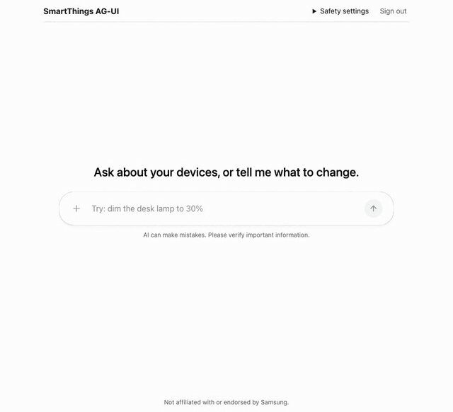

# How it works

A closer look at what the [README](../README.md) summarises: the frontend-tool loop, the cards, the safety rules, sign-in, the agent's fixes for the LlamaIndex AG-UI router, and SmartThings behaviours worth knowing. Everything here was run; versions are at the end.

## The frontend-tool loop

The browser registers SmartThings capabilities with CopilotKit as frontend tools and connects straight to the agent over AG-UI ("direct connect": no Node runtime, no proxy). A request that needs a device takes several short agent runs:

```
run 1  browser → agent: messages + tool schemas + home context
       agent → browser: tool call set_level {deviceId, level}; run ends
       browser: runs set_level against api.smartthings.com with the user's token,
                reads the device's status back
run 2  browser → agent: same, plus the tool result {label, room, state}
       agent → browser: a one-sentence answer; run ends
```

The agent ends each run when the model calls a frontend tool and never answers that call itself; the browser executes it and calls back. The SmartThings token is used only for `fetch` calls from the browser to `api.smartthings.com` (which allows CORS from any origin), so it never appears in an agent request; the integration tests assert that.

**Context.** The device and scene list (one compact line each, about 60 characters a device) goes to the agent as AG-UI context, so most requests need no `list_devices` round trip.

**Typed tools.** `set_switch`, `set_level`, `set_color`, `set_thermostat` and `get_device_status` cover the common capabilities with a few typed parameters, which models call much more reliably than one generic tool. Everything else goes through `execute_command`, which only reaches an allowlist of capabilities and checks the arguments against the capability definition from the public API (`GET /v1/capabilities/{id}/{version}`, whose command arguments are JSON Schema). Arguments are coerced from strings where needed, because the LlamaIndex router sends every frontend-tool parameter as a string (below).

## Cards

Device and scene cards are [A2UI](https://a2ui.org) v0.9 surfaces rendered with `@copilotkit/a2ui-renderer`.



- **The agent chooses what, the browser builds how.** `show_devices(room)` or `show_devices(deviceIds)` returns the devices' states to the agent; the browser turns the same data into a surface from a three-component catalog (`TileGrid`, `DeviceTile`, `SceneButton`). The model never writes A2UI JSON, and the catalog's schemas never enter its context. (CopilotKit's `a2ui` prop would add the full component schemas to every request.)
- **Templates are pure binding.** A2UI templates can't compute, so `packages/smartthings-agui/src/a2ui/surfaces.ts` derives every display field (`stateText`, colour, which controls to show) before emitting `createSurface`, `updateComponents` and `updateDataModel`.
- **Live state without polling.** Every status read, from any tool or any card, goes into one shared store, and each card on screen applies an `updateDataModel` for the tiles it shows. Switch a lamp from a card and ask the agent about it, or the other way round: every card showing that lamp follows. Changes made outside the app (a wall switch) aren't pushed: real-time device events need a SmartThings subscription, which the public API offers to installed SmartApps through a webhook, so it needs a server.
- **Controls.** On/off, a level slider that sends one command when released (SmartThings rate-limits per token), and scene buttons. A press runs through the same tool handlers as the agent, so the safety rules below apply to clicks too, and it needs no agent turn.

Three renderer details that aren't in its type definitions (`@copilotkit/a2ui-renderer` 1.79.0): a child list arrives as `{id, basePath}` nodes and `children` must be called as `children(id, basePath)`, or relative bindings render empty; an Action prop arrives as a function that dispatches the action with its context resolved; a bound prop comes with a `set<Prop>` setter that writes the data model. The slider uses the last two together: write the new level, then dispatch an action whose context reads it. `packages/smartthings-agui/test/a2ui.test.tsx` pins all three.

Catalog definitions use `zod/v3`: with Zod 4 the renderer silently drops every prop. For TypeScript, `tsconfig.json` maps `zod/v3` to a types-only `zod-v3-types` package (zod 3.25.76), the copy the renderer's types use.

## Safety rules

All in [`policy.ts`](../packages/smartthings-agui/src/policy.ts):

1. Commands for `lock`, `garageDoorControl`, `doorControl`, `securitySystem` and `valve` are denied unless the user turns that capability on in the app. Until then the `confirm_command` tool isn't offered to the agent at all.
2. When it's on, `confirm_command` is human-in-the-loop: a card says what will happen, and the command runs only when the person presses the button. The policy is checked again at that moment.
3. A device that has any of those capabilities can't be commanded through any other tool, and its card has no controls. (Some valves and garage openers also expose `switch`.)
4. Scenes the agent runs always ask first: a scene can unlock a door, and the public API doesn't say what a scene contains (`GET /scenes/{id}` returned `"devices": []` both for a lighting scene and for a test scene known to switch three devices). On a scene card, the person's own press is the confirmation. Since the devices a scene touches aren't known, the devices already shown in cards are read once more after it runs, so the cards reflect it.

`doorControl` is on the list because garage door openers use it as well as `garageDoorControl` (the `VIRTUAL_GARAGE_DOOR_OPENER` prototype does). The list is hard-coded rather than derived from the API's per-command `sensitive` flag, which marks commands whose arguments carry secrets, not commands with physical effects: `lock.unlock` reports `"sensitive": false`.

## Sign-in

- **Personal access tokens** are the quick path for development. They expire 24 hours after creation.
- **OAuth** uses an OAuth-In app created with the SmartThings CLI (`smartthings apps:create`). The documented token exchange needs the app's client secret as HTTP Basic auth, which can't ship in a browser, so `agent/token_exchange.py` (a separate service from the agent, on its own port) adds the secret to the code exchange and to refreshes, returns only the token fields, accepts only the registered redirect URI and allows only the app's origin. It stores and logs nothing. The browser keeps tokens in memory and refreshes five minutes before expiry.
- **Hosts.** The documented authorize URL, `https://api.smartthings.com/oauth/authorize`, answered 403 Forbidden to every request when this was built (any client id, browser user agent or not). The sign-in goes through `https://oauthin-regional.api.smartthings.com/oauth/authorize`, the host the open-source SmartThings CLI uses, and codes are redeemed at the same host's `/oauth/token`. Verified end to end: sign-in, code exchange, commands with the OAuth token, a refresh and a command after it.
- The SmartThings CLI itself signs in with PKCE and no secret, using its own pre-provisioned client; nothing public says an app you create can be a public client, so this project doesn't rely on it.

## The reference agent and the LlamaIndex AG-UI router

`agent/serve.py` is FastAPI plus `llama-index-protocols-ag-ui`'s workflow router, with a system prompt and no SmartThings code. `agent/router.py` fixes three router behaviours (0.5.0) on the way in; tests in `agent/tests/` pin each against the stock router, so a release that fixes one shows up as a failing test.

1. **Tool history sent as text.** Earlier tool calls reach the model as `<tool_call>…</tool_call>` text and tool results as user messages. Models then copy the text instead of calling tools: the model tested did so on every replay of a second request, so every turn after the first silently did nothing. The fix converts them to native tool-call blocks and `tool` messages (0/3 native calls before, 3/3 after, on the same request).
2. **Context ignored.** `RunAgentInput.context` (CopilotKit's `useAgentContext`) never reaches the model. The fix renders it into the system message.
3. **System prompt duplicated.** The router's message snapshot echoes its own system prompt to the client, which sends it back, and the router adds another each run. The fix sends exactly one system message.

A fourth behaviour is worked around in the browser: the router rebuilds frontend-tool parameters as plain strings, dropping `enum`, types and ranges. Tool descriptions repeat the constraints in words (`describeSchema` in `capabilityTools.ts`), and handlers accept strings.

**Models.** The agent takes any OpenAI-compatible endpoint (`AGENT_API_BASE`, `AGENT_API_KEY`, `AGENT_MODEL`) whose model supports native tool calls; `AGENT_EXTRA_BODY` passes provider-specific options as JSON. `--scripted` runs a deterministic stand-in model for the tests.

## Testing against virtual devices

SmartThings virtual devices behave like real ones through the API, so nobody needs real hardware. Create one with the endpoint the SmartThings CLI uses:

```sh
curl -X POST https://api.smartthings.com/v1/virtualdevices/prototypes \
  -H "Authorization: Bearer $TOKEN" -H "Content-Type: application/json" \
  -d '{"name":"Test Dimmer","owner":{"ownerType":"LOCATION","ownerId":"<locationId>"},"prototype":"VIRTUAL_DIMMER_SWITCH"}'
```

Prototypes include `VIRTUAL_SWITCH`, `VIRTUAL_DIMMER_SWITCH`, `VIRTUAL_COLOR_BULB`, `VIRTUAL_LOCK`, `VIRTUAL_CONTACT_SENSOR`, `VIRTUAL_THERMOSTAT`, `VIRTUAL_GARAGE_DOOR_OPENER` and `VIRTUAL_MULTI_SENSOR`. Putting them in their own room keeps `show_devices` away from real hardware. Delete them with `DELETE /v1/devices/{deviceId}`.

Behaviours to expect:
- New virtual devices start with random values (a thermostat at 9290°), so the cards round numbers and tolerate odd units.
- The colour bulb accepts `setColor` (HTTP 200) but ignores it, in both the `{hue, saturation}` and `{hex}` forms; `setHue` and `setSaturation` work, so `set_color` sends those (they're standard `colorControl` commands).
- `setLevel` doesn't switch a virtual dimmer on.

`apps/demo/e2e/drive.mjs` drives the demo against them in Chromium, Chrome, Firefox or WebKit, headed or not, optionally emulating a phone (prompts, confirmation clicks, card controls, screenshots or a video).

## Trying it on a phone

The phone and the computer running the agent must be on the same network. Expose both on it, pointing the app at the computer's address (`192.168.1.20` here):

```sh
cd agent && AGENT_HOST=0.0.0.0 AGENT_ORIGINS=http://192.168.1.20:5173 \
  AGENT_API_BASE=… AGENT_API_KEY=… AGENT_MODEL=… uv run python serve.py
cd apps/demo && VITE_AGENT_URL=http://192.168.1.20:8000/run npx vite --host
```

Then open `http://192.168.1.20:5173` on the phone. Over plain http on a network address the page isn't a *secure context*, so browser APIs such as `crypto.randomUUID` don't exist; the app avoids them (checked in WebKit and Chromium). For OAuth from the phone, the redirect URI registered for the OAuth app and `SMARTTHINGS_REDIRECT_URI` must be that address too, and the token exchange needs `EXCHANGE_HOST=0.0.0.0` and the address in `ALLOWED_ORIGINS`. Anyone on the same network can reach both services while they run, so stop them afterwards.

## Versions tested

`@copilotkit/react-core` 1.79.0, `@ag-ui/client` 1.0.2, `@copilotkit/a2ui-renderer` 1.79.0 (`@a2ui/web_core` 0.10.4, A2UI v0.9), `llama-index-protocols-ag-ui` 0.5.0, `ag-ui-protocol` 1.0.0, React 19.3, Node 24.14, Python 3.14.7, and a hosted OpenAI-compatible model. Browsers, through Playwright 1.58.2 on the production build: Google Chrome 155 (headed), Firefox 146, WebKit 26, and iPhone 15 and Pixel 7 emulation. Not yet tested: local models, real hardware, the Safari app itself and real phones.
